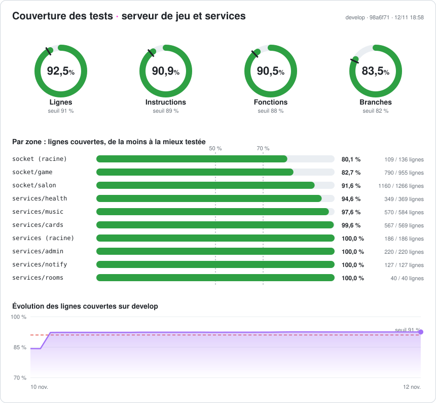

# ZIK. 🎵 — dépôt de l'équipe

[](https://github.com/Tfoucher5/ZIK/actions/workflows/ci.yml?query=branch%3Adevelop)
[](https://github.com/Tfoucher5/ZIK/actions/workflows/ci.yml?query=branch%3Adevelop)
[](https://github.com/Tfoucher5/ZIK/actions/workflows/watchdog.yml)

Blind test multijoueur : **Jouer en ligne** (rooms, classements, cartes, Zikle) et **ZIK Soirée** (une TV, une régie, les téléphones des joueurs), vendu aux bars, campings, entreprises et associations avec **ZIK Pro**.

Les règles de travail sont dans [`CLAUDE.md`](CLAUDE.md). Ce README sert à s'y retrouver vite.

## 🚦 Tout va bien ?

[](https://github.com/Tfoucher5/ZIK/actions/workflows/ci.yml?query=branch%3Adevelop)

| Où regarder                                                                                             | Ce que ça dit                                                                              |
| ------------------------------------------------------------------------------------------------------- | ------------------------------------------------------------------------------------------ |
| Badges ci-dessus                                                                                        | CI de `develop`, part du serveur couverte par les tests, chien de garde de la prod         |
| [`/statut`](https://www.zik-music.fr/statut) · [`/admin/statut`](https://www.zik-music.fr/admin/statut) | État des services en prod, public et détaillé                                              |
| Commentaire « Couverture » sur chaque PR                                                                | Même tableau de bord pour la PR, plus ✅ / ⚠️ / ❌ face au seuil et l’écart avec `develop` |
| Railway                                                                                                 | Logs et déploiements de `[PROD]` et `[DEV]`                                                |

## 🌍 Environnements

|                        | Prod                                         | Staging                                                                                      |
| ---------------------- | -------------------------------------------- | -------------------------------------------------------------------------------------------- |
| Branche                | `master`                                     | `develop`                                                                                    |
| Site                   | [www.zik-music.fr](https://www.zik-music.fr) | [zik-dev-dev-developpement.up.railway.app](https://zik-dev-dev-developpement.up.railway.app) |
| Railway                | `[PROD] - Production`                        | `[DEV] - Développement`                                                                      |
| Supabase               | `ZIK`                                        | `ZIK-DEV`                                                                                    |
| Paiements, mails, push | réels                                        | clés de test, rien ne part                                                                   |

Le `.env` local pointe **toujours** sur le staging.

## 🛠️ Démarrer en local

```bash
npm ci
cp .env.example .env    # clés du projet ZIK-DEV, chaque variable dit où la trouver
npm run dev             # site + Socket.io sur http://localhost:5173
```

Données de test sur le staging : `node scripts/seed-staging.mjs <pseudo admin>`.

## ✅ Avant une PR

```bash
npx eslint . && npx prettier --check . && npx svelte-check && npx vitest run --coverage && npm run build
```

Une tâche = une branche depuis `develop` (`feature/…`, `fix/…`, `chore/…`), une PR fusionnée en squash. `master` ne reçoit que les releases et les hotfix, en merge commit. Le détail, et la Définition de terminé, sont dans [`CLAUDE.md`](CLAUDE.md).

Avec Claude Code : `/demarrer`, `/tests`, `/relire`, `/terminer`, `/migration`, `/release`, `/hotfix`, `/incident`, `/idees`.

## 🗺️ Où est quoi

| Dossier                      | Contenu                                                                         |
| ---------------------------- | ------------------------------------------------------------------------------- |
| `src/lib/server/socket/`     | Temps réel : `game/` (rooms en ligne), `salon/` (ZIK Soirée)                    |
| `src/lib/server/services/`   | Accès base et logique métier, par domaine                                       |
| `src/lib/components/`        | Composants Svelte, par domaine                                                  |
| `src/routes/`                | Pages et API (fines : elles appellent les services)                             |
| `supabase/migrations/`       | Toute modification de la base, appliquée par la CI                              |
| `static/css/`                | CSS global par domaine                                                          |
| `scripts/`                   | Seed du staging, test de charge, prospection, couverture                        |
| `docs/audit/`                | Plan en cours : [`2026-11-02-a-valider.md`](docs/audit/2026-11-02-a-valider.md) |
| `docs/design/` · `DESIGN.md` | Écrans cibles et charte                                                         |
| `docs/idees/`                | Rapports de `/idees` et décisions                                               |

## ⚙️ Automatisations (GitHub Actions)

| Workflow          | Rôle                                                                                                                                  |
| ----------------- | ------------------------------------------------------------------------------------------------------------------------------------- |
| `ci.yml`          | Contrôles, tests et couverture, puis migrations (staging sur `develop`, prod sur `master`). Railway attend son feu vert pour déployer |
| `watchdog.yml`    | Vérifie la prod toutes les 5 min                                                                                                      |
| `charge.yml`      | Test de charge des soirées, sur le staging uniquement                                                                                 |
| `prospection.yml` | Mails de prospection ZIK Pro, un envoi par jour de semaine                                                                            |
| `indexnow.yml`    | Signale les pages mises à jour aux moteurs de recherche                                                                               |

Stack : SvelteKit 5 (runes), Socket.io, Supabase, Node.js, hébergé sur Railway.
