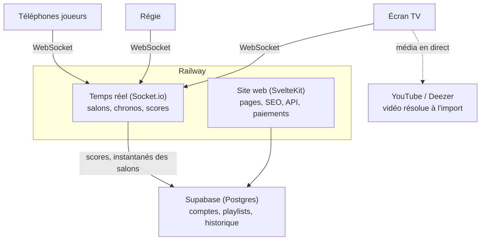

# Audit ZIK — mode salon, infra, base, marché

Nov 2, 2026 · @Theo Foucher

## Synthèse

ZIK n'a pas un problème de charge, il a un problème de fragilité. Au pic de la semaine, le serveur a utilisé moins de 10 % de sa RAM et un peu plus d'un quart de son CPU. Ce qui peut casser une soirée, ce sont cinq points précis, tous corrigeables en quelques jours.

Chiffres relevés le 2 novembre 2026 (prod Railway, base Supabase, dépôt GitHub) :

| Indicateur                         | Valeur                                                        |
| ---------------------------------- | ------------------------------------------------------------- |
| Parties salon sur 30 jours         | 931 (56 % de toutes les parties)                              |
| Hôtes salon distincts sur 30 jours | 52                                                            |
| Joueurs par partie salon           | 4,6 en moyenne, 65 au maximum                                 |
| Pics de parties salon              | vendredi 220, samedi 217, dimanche 183 (sur 30 jours)         |
| Abonnements Pro actifs             | 12 (6 Soirée, 5 Mensuel, 1 Annuel)                            |
| Serveur Railway (7 jours)          | RAM 0,29 Go en moyenne, 0,77 Go au pic, pour 8 Go disponibles |
| Base Supabase                      | 82 Mo, 42 tables, toutes dans `public`, plan Free             |
| Tests automatisés                  | 307 tests Vitest dans 36 fichiers                             |

Les cinq problèmes critiques, par ordre d'urgence :

1. **N'importe qui peut modifier les scores et lire des données admin.** Des fonctions de la base (`flush_player_score`, `update_player_stats`, `update_player_streaks`, les 17 `admin_*`) s'exécutent avec les droits du propriétaire et sont appelables avec la clé publique, sans vérifier qui appelle.
2. **Un seul message mal formé fait tomber tout le serveur**, donc tous les salons en cours. Testé : un `salon_submit_guess` avec un nombre au lieu d'un texte tue le process Node.
3. **La musique dépend d'une recherche YouTube faite depuis l'IP de Railway.** C'est la cause de l'incident du vendredi 30/10 : YouTube a bloqué le serveur comme robot.
4. **Tout l'état des salons vit en mémoire.** Chaque déploiement ou redémarrage efface les soirées en cours. Le 30/10, un déploiement a eu lieu à 22h55, en pleine soirée.
5. **Pas de vrai environnement de dev, et la prod est sur Supabase Free.** Le serveur de dev local tape sur la base de prod, il n'y a pas de sauvegarde exploitable, et l'historique des migrations ne correspond plus aux fichiers du dépôt.

Ordre d'attaque : 1 et 2 cette semaine (quelques heures chacun), puis Supabase Pro et l'env de dev, puis 3 et 4 avant le prochain week-end chargé. Le détail est dans les piliers ci-dessous et dans la roadmap.

## Décisions du 2 novembre

Arbitrages pris après lecture de l'audit. Ils priment sur les recommandations des piliers quand les deux divergent.

| Sujet                           | Décision                                                                                                                 | Conséquence                                                                                                                    |
| ------------------------------- | ------------------------------------------------------------------------------------------------------------------------ | ------------------------------------------------------------------------------------------------------------------------------ |
| Budget                          | Seulement Railway (Hobby, Pro si les abonnements le financent) et Supabase (Pro). Aucun service tiers payant ou à quota. | Surveillance, page de statut, journal d'erreurs et alertes faits maison. Pas de Redis, pas de Sentry, pas de Better Stack.     |
| Redémarrages                    | Rares et presque toujours déclenchés par nous. Pas de Redis.                                                             | Annonce du redémarrage aux écrans, instantané des salons dans Postgres, reconnexion automatique.                               |
| Scores                          | Un joueur parti en cours de partie compte dans le résultat final, et son score apparaît sur son profil.                  | Bug actuel à corriger : un joueur retiré après 90 s d'absence n'est plus dans `salon_players` ni dans le classement de soirée. |
| Bot Discord                     | Mis en sommeil.                                                                                                          | Plus de déploiement, fonction `update_player_stats_discord` révoquée puis supprimée.                                           |
| Environnements                  | Prod, staging, preview, avec tests bloquants. Exigence maximale même si ça ralentit.                                     | CI complète, protection des branches, aucune fusion sans tests verts.                                                          |
| Standard de travail             | Le `CLAUDE.md` porte toutes les règles, avec des agents dédiés et un modèle de branches.                                 | Livrable à part entière, écrit avant la refonte.                                                                               |
| Base                            | Ranger les tables par domaine, lisible pour nous.                                                                        | Refonte des schémas confirmée (pilier 2).                                                                                      |
| Nom                             | **ZIK Soirée**, avec un choix de direction dès l'arrivée sur le site.                                                    | Deux portes : jouer en ligne, animer une soirée.                                                                               |
| Lieux                           | Historique des parties par lieu, inclus dans Pro, pour les entreprises, campings et organisations.                       | Reprendre la fonction « lieux » archivée sur la branche `archive/lieux` plutôt que repartir de zéro.                           |
| Refonte du salon                | Design fait avec Stitch, à partir de la liste de ce qu'on veut voir et piloter.                                          | Phase à part, après les fondations.                                                                                            |
| Marque blanche, offre Animateur | À étudier, pas prioritaire. Le prix de l'offre Animateur reste à valider.                                                | Hors planning pour l'instant.                                                                                                  |
| Calendrier                      | Pas de dates : on avance par phases, chaque phase finie et testée avant la suivante.                                     | Roadmap réécrite en phases.                                                                                                    |

## 1. Temps réel et mode salon

Le code du salon est déjà bien pensé pour le terrain : délais de grâce larges pour l'écran TV (10 min en partie, 2 h en pause), 90 s pour un téléphone, reconnexion par jeton, anti-spam de 300 ms sur les réponses, réponse envoyée seulement à la régie. Les failles sont ailleurs : tout repose sur un seul process Node, sans filet, et sur YouTube côté serveur.



Aujourd'hui, site et temps réel tournent dans un seul process, et le serveur cherche les vidéos lui-même.

Le temps réel devient un service à part, son état est sauvegardé dans Postgres avant chaque redémarrage, et la TV va chercher la musique elle-même : le serveur ne parle plus à YouTube pendant une partie.

### Ce qui s'est passé le vendredi 30/10

Reconstitué à partir des logs Railway et des commits (heures de Paris) :

| Heure              | Fait                                                                                                                                                                                   |
| ------------------ | -------------------------------------------------------------------------------------------------------------------------------------------------------------------------------------- |
| 22h33 → 22h46      | La recherche YouTube du serveur échoue en boucle (`fetch failed`). Chaque échec saute un titre : une cinquantaine de titres brûlés en 13 minutes, des parties qui se terminent seules. |
| 22h53              | Merge du correctif v3.20.7 (recherche via yt-dlp).                                                                                                                                     |
| 22h55              | Redémarrage du conteneur pour déployer : tous les salons encore ouverts sont perdus.                                                                                                   |
| 23h03 → 23h07 et + | yt-dlp est bloqué à son tour : YouTube répond « Sign in to confirm you're not a bot ».                                                                                                 |
| 31/10              | v3.20.8 puis v3.21.0 : cache des vidéos en base, repli sur l'extrait Deezer, attente au lieu de sauter les titres.                                                                     |

La cause racine n'est pas corrigée : YouTube bloque les IP de datacenter, et Railway en est une. Le cache et le repli Deezer limitent les dégâts, mais tout titre pas encore en cache dépend toujours d'une recherche depuis le serveur.

### Points de défaillance unique

| SPOF                                                                                                   | Effet en soirée                                                                 | Correctif                                                                                                                                                                                        |
| ------------------------------------------------------------------------------------------------------ | ------------------------------------------------------------------------------- | ------------------------------------------------------------------------------------------------------------------------------------------------------------------------------------------------ |
| Recherche YouTube depuis le serveur (API interne + yt-dlp)                                             | Titres injouables, partie bloquée ou vidée                                      | Résoudre la vidéo à l'import de la playlist, pas en partie. Faire la recherche depuis le navigateur de l'hôte (IP résidentielle) ou via l'API YouTube Data avec une clé. Garder Deezer en repli. |
| Un seul process Node pour le site, les salons, les parties classiques, yt-dlp et les tâches planifiées | Une exception, un pic SSR ou un yt-dlp qui sature le CPU touche tous les salons | Garde-fou par handler (ci-dessous), puis séparer le temps réel du site web en deux services Railway                                                                                              |
| Aucun `uncaughtException`, aucune validation des payloads                                              | Un message mal formé tue le process                                             | Wrapper `safe()` + validation sur les 40 handlers                                                                                                                                                |
| État des salons en mémoire (`globalThis.__zik_salonRooms`)                                             | Déploiement, crash ou redémarrage = soirées effacées                            | Instantané de l'état à chaque changement de phase + restauration au démarrage                                                                                                                    |
| Déploiement automatique à chaque push sur `master`                                                     | Un merge le vendredi soir coupe les salons                                      | Gel des déploiements du jeudi 18h au dimanche 2h, déploiement manuel en dehors                                                                                                                   |
| Le workflow de lint pousse un commit auto sur `master`                                                 | Deux déploiements à 30 s d'écart (vu le 29/10)                                  | Le lint vérifie sans pousser ; le formatage se fait avant le commit                                                                                                                              |

### Le crash par message mal formé

Testé en isolant le même schéma que `answers.js` : un client émet `salon_submit_guess` avec `{ guess: 42 }`. `guess?.slice` n'est pas une fonction, l'exception remonte hors de Socket.io et Node s'arrête. Le `process.on("unhandledRejection")` de `server.js` ne couvre que les promesses. Un handler appelé sans argument (`socket.emit("salon_join_player")`) plante pareil sur la déstructuration. Parmi les 40 handlers, six déstructurent leur payload sans valeur par défaut, et les types ne sont vérifiés qu'au cas par cas.

Correctif en deux couches, à poser dans `src/lib/server/socket/` :

```js
// safe.js : aucun handler ne peut plus tuer le process
export function safe(name, fn) {
  return async (payload = {}, ack) => {
    try {
      if (payload === null || typeof payload !== "object") return;
      await fn(payload, typeof ack === "function" ? ack : () => {});
    } catch (err) {
      console.error(`[socket] ${name}`, err?.stack ?? err);
    }
  };
}

// usage
socket.on(
  "salon_submit_guess",
  safe("salon_submit_guess", ({ guess }) => {
    if (typeof guess !== "string") return;
    // ...
  }),
);
```

Et dans `server.js`, en dernier filet : `process.on("uncaughtException", (e) => console.error("[uncaught]", e))`. Ce n'est pas propre en théorie, mais tant que l'état vit en mémoire, garder le process vivant vaut mieux que perdre toutes les soirées.

### État et redémarrages annoncés

Pas de Redis : à la charge actuelle, il n'apporte rien, et un redémarrage est presque toujours un déploiement qu'on a lancé. On gère donc le redémarrage prévu proprement, avec Postgres comme filet :

1. **Annonce.** Sur `SIGTERM` (envoyé par Railway au déploiement), le serveur émet `salon_restart` à tous les salons. La TV et les téléphones affichent « Mise à jour en cours, reprise automatique dans quelques secondes », et le chrono se met en pause.
2. **Instantané.** Dans la même seconde, chaque salon est écrit sans ses timers ni sockets dans une table `salon.snapshots` (code, données JSON, date). Réglage Railway `drainingSeconds` à 30 s pour en laisser le temps.
3. **Reprise.** Au démarrage, le nouveau conteneur relit les instantanés de moins de 15 minutes. Les clients se reconnectent seuls et réémettent `salon_join_host` ou `salon_join_player` (code + clé ou jeton), le chemin de reconnexion qui existe déjà. La manche coupée reprend depuis le début.
4. **Annonce manuelle.** Un bouton dans l'admin prévient tous les salons ouverts d'une maintenance dans N minutes, pour les cas où l'on peut choisir le moment.

Le gel des déploiements du jeudi soir au dimanche reste la première protection. Le mécanisme ci-dessus couvre le reste, y compris un crash, pour peu que l'instantané soit aussi écrit à chaque changement de phase. Si un jour le trafic impose plusieurs instances, Redis redeviendra le bon outil, mais pas avant.

### Mobile, veille et coupures réseau

- Téléphone verrouillé plus de 90 s : le joueur est retiré et son score avec. En soirée de bar, 90 s c'est court (passage au comptoir, appel). Passer à 10 min en partie, et garder le score même après retrait, rattaché au jeton.
- Pseudo + jeton : un joueur qui vide son navigateur perd son jeton et ne peut plus reprendre son pseudo (« déjà pris »). Prévoir une reprise validée par la régie.
- Activer `connectionStateRecovery` de Socket.io (2 min) : après une micro-coupure, le client reçoit les événements manqués sans rejoindre à nouveau. Ça ne survit pas à un redémarrage, d'où l'instantané ci-dessus.
- Chrono : le serveur envoie `salon_timer_update` chaque seconde à tous. Envoyer plutôt l'heure de fin (`endsAt`, horloge serveur) et laisser chaque écran compter seul, avec un écart d'horloge mesuré au `connect`. Moins de messages, et un écran qui rate un tick reste juste.

### Triche et données exposées

- Les téléphones des joueurs reçoivent `videoId` et `audioUrl` à chaque manche (`rounds.js`, `salon_round_start` vers `salon:players`). Un joueur curieux retrouve le titre en un clic. Les téléphones n'en ont pas besoin : n'envoyer le média qu'aux écrans.
- L'écran TV est public avec le seul code, et il reçoit le média : quelqu'un qui ouvre l'écran sur son téléphone voit l'ID de la vidéo. Acceptable si la page TV demande la clé de régie pour recevoir le média, et qu'un écran sans clé n'affiche que le jeu.
- Validation : typer et borner chaque champ à l'entrée (chaînes, longueurs, entiers, énumérations). Un schéma Zod ou Valibot par événement, appelé dans `safe()`, suffit.
- Limite de débit par socket, en plus des 300 ms par réponse : par exemple 20 événements par seconde tous types confondus, déconnexion au-delà. Ça protège aussi des boucles de bug côté client.
- Code de salon à 6 caractères sur 32 symboles : environ un milliard de combinaisons, ça suffit. Limiter quand même les tentatives de `salon_join_*` ratées par IP.

## 2. Base de données Supabase

La base est petite (82 Mo) et les performances ne sont pas un sujet aujourd'hui. Les vrais problèmes sont la sécurité des fonctions, l'absence de sauvegardes sur le plan Free, et des migrations qui ne permettent plus de reconstruire la base à l'identique.

### Sécurité : à corriger tout de suite

Les conseillers Supabase et la lecture des fonctions montrent ceci :

| Problème                                                     | Gravité  | Détail                                                                                                                                                                                                                                 |
| ------------------------------------------------------------ | -------- | -------------------------------------------------------------------------------------------------------------------------------------------------------------------------------------------------------------------------------------- |
| Fonctions `SECURITY DEFINER` appelables avec la clé publique | Critique | 26 fonctions, dont `update_player_stats`, `update_player_streaks` et `flush_player_score`, qui modifient score, XP et ELO de n'importe quel `user_id` sans vérifier `auth.uid()`. Les classements sont falsifiables par n'importe qui. |
| Fonctions `admin_*` ouvertes à `anon`                        | Élevée   | 17 fonctions. `admin_at_risk_users` renvoie pseudos et dates d'activité à quiconque appelle l'API.                                                                                                                                     |
| `search_path` non fixé sur 16 fonctions                      | Moyenne  | Risque classique de détournement d'une fonction `SECURITY DEFINER`.                                                                                                                                                                    |
| Protection contre les mots de passe fuités désactivée        | Faible   | Un réglage Auth à activer.                                                                                                                                                                                                             |
| 11 tables avec RLS et aucune politique                       | Normal   | `prospects`, `salon_players`, `push_subscriptions`… ne sont lues que par le serveur avec la clé de service. C'est voulu, à garder.                                                                                                     |

Ordre pour corriger sans casser la prod. Le serveur appelle `update_player_stats` et `update_player_streaks` avec le client anonyme (`socket/game/results.js`, `services/achievements.js`). Il faut d'abord passer ces appels sur `getAdminClient()`, déployer, puis révoquer :

```sql
-- après le passage des appels serveur sur la clé de service
revoke execute on function public.update_player_stats(uuid, integer, integer, integer, integer) from anon, authenticated;
revoke execute on function public.update_player_streaks(uuid, boolean) from anon, authenticated;
revoke execute on function public.update_player_stats_discord(uuid, integer) from anon, authenticated;
drop function public.flush_player_score(uuid, integer); -- plus appelée nulle part dans le code

-- toutes les fonctions admin_* : réservées au serveur
do $$ declare f record; begin
  for f in select p.oid::regprocedure as sig from pg_proc p
           join pg_namespace n on n.oid = p.pronamespace
           where n.nspname = 'public' and p.proname like 'admin\_%'
  loop execute format('revoke execute on function %s from anon, authenticated', f.sig); end loop;
end $$;

alter default privileges in schema public revoke execute on functions from anon, authenticated;
```

Le bot Discord est mis en sommeil : `update_player_stats_discord` est révoquée avec les autres, puis supprimée quand le service Railway `zik-discord-bot` (jamais déployé) sera retiré. La dernière ligne du script oblige ensuite à ouvrir explicitement chaque nouvelle fonction publique, ce qui est le bon réflexe.

### Connexions et charge

Le serveur Node passe par `supabase-js`, donc par l'API REST (PostgREST) en HTTP, jamais par une connexion Postgres directe. Il n'y a pas de pool à saturer de son côté : Supavisor n'entre en jeu que si un jour un client Postgres direct est ajouté (migrations en CI, worker). Dans ce cas, utiliser le port 6543 en mode transaction.

Une fin de partie salon écrit trois choses : une ligne `games` au lancement, un `insert` groupé dans `salon_players` et un `update` de `games` à la fin. Même 50 salons qui finissent à la même minute font 150 requêtes, ce que la plus petite instance absorbe sans effort. Le vrai risque de charge est ailleurs : le chargement des playlists à la création du salon (une requête par playlist, puis le cache vidéo par paquets de 300), et les pages publiques rendues côté serveur si le SEO amène du trafic.

**Bug à corriger : les joueurs partis perdent leur score.** À la fin d'une partie, `recordSalonPlayers` (`persist.js`) n'écrit que les joueurs encore présents dans le salon. Un téléphone absent plus de 90 s est retiré de `salon.players` : il disparaît de `salon_players` et du classement de soirée (`nightView` ignore la réserve `nightBank`). Correctif : garder chaque joueur parti dans une liste `salon.departed` avec son score, son équipe et son `userId`, et l'inclure dans l'enregistrement final et le classement, marqué « parti ».

**Scores salon sur le profil.** Aujourd'hui, une partie salon ne crée volontairement aucune ligne `game_players`, pour ne pas fausser les classements en ligne. Pour que le joueur connecté retrouve ses soirées sur son profil, sans toucher aux classements : lire `salon_players` par `user_id` dans le profil (section « Mes soirées »), avec le lieu, la date, le rang et le score. L'écriture reste unique, en fin de partie, en un seul `insert` groupé qui contient aussi les partants.

Supabase Realtime n'est pas utilisé, et c'est le bon choix. Tout le temps réel passe par Socket.io sur Railway, donc aucun quota de messages Supabase à surveiller. Garder cette règle.

### Performances à nettoyer

- 34 politiques RLS appellent `auth.uid()` ligne par ligne. Les réécrire en `(select auth.uid())` : gain immédiat sur les grosses tables (`custom_playlist_tracks`, 21 900 lignes).
- Plusieurs politiques permissives en double sur `rooms`, `track_answers` (4 politiques en lecture) et `custom_playlists` : les fusionner en une par action.
- 15 clés étrangères sans index (`game_results.game_id`, `game_results.user_id`, `room_playlists.playlist_id`…) : un index chacune.
- Schéma `backup` avec deux copies de juillet sans clé primaire : à exporter puis supprimer.

### Migrations : la base n'est plus reproductible

L'historique de Supabase compte 63 migrations, le dossier `supabase/migrations` en a 46, et les deux ne se recouvrent qu'en partie. Des changements récents (cache vidéo du 31/10, suppression des tables `venue*`) sont bien en base mais absents de l'historique. Conséquence directe : impossible de créer une base de dev ou une branche Supabase fidèle à partir du dépôt.

Remède en une fois : un `supabase db dump --schema public` de la prod, commité comme migration de base (`00000000000000_baseline.sql`), l'ancien dossier archivé, puis toute modification uniquement par fichier de migration appliqué par la CI. Plus de SQL tapé à la main dans le dashboard de prod.

### Refonte des schémas

Les 42 tables sont toutes dans `public`, qui est aussi le schéma exposé par l'API. Proposition de rangement par domaine :

| Schéma    | Tables                                                                                                                                 | Exposé à l'API publique   |
| --------- | -------------------------------------------------------------------------------------------------------------------------------------- | ------------------------- |
| `public`  | `profiles` et vues de lecture publiques (classements)                                                                                  | Oui                       |
| `catalog` | `tracks`, `custom_playlists`, `custom_playlist_tracks`, `track_answers`, `answer_types`, `track_stats`, `track_issues`                 | Oui, en lecture selon RLS |
| `play`    | `games`, `game_players`, `game_results`, `rooms`, `room_playlists`, `daily_songs`, `daily_results`, `zikle_pool`, `weekly_challenges`… | Oui, selon RLS            |
| `salon`   | `evenings` (nouvelle), `salon_players`, `pro_subscriptions`                                                                            | Non, serveur seulement    |
| `cards`   | les 8 tables `card*` et `user_card*`                                                                                                   | Oui, selon RLS            |
| `social`  | `follows`, `friendships`, `notifications`, `push_subscriptions`                                                                        | Oui, selon RLS            |
| `ops`     | `admin_audit_log`, `reports`, `prospects`, `prospect_replies`, `visit_sources`, `site_settings`, fonctions `admin_*`                   | Non                       |

Pour `ops` et `salon`, la protection ne repose plus sur des politiques RLS bien écrites mais sur les droits du schéma : `revoke usage on schema ops from anon, authenticated` et `grant usage ... to service_role`. Pour que le serveur y accède par `supabase-js` (`getAdminClient().schema("ops")`), le schéma doit figurer dans les « Exposed schemas » de l'API ; sans le droit `usage`, la clé publique reste refusée.

Pour le mode salon, la nouvelle table `salon.evenings` donne enfin une vue « soirée » : un hôte, un lieu, une date, plusieurs parties. Elle sert l'historique et l'export Pro déjà annoncés, et le classement de la soirée aujourd'hui gardé en mémoire.

La migration se fait table par table, sans coupure : créer le schéma, `alter table ... set schema`, laisser une vue de compatibilité dans `public` le temps de mettre le code à jour, puis supprimer la vue. À faire uniquement une fois l'env de dev en place.

## 3. Railway, environnements, CI/CD et surveillance

Aujourd'hui, un push sur `master` part en prod sans attendre les tests (`checkSuites: false` sur le service), il n'y a ni healthcheck ni environnement de test, et la seule alerte est le push admin déclenché par l'app elle-même. Le projet Railway a déjà un environnement `[DEV] - Développement`, vide : c'est la base du plan.

### Trois niveaux d'environnement

| Niveau  | Railway                                           | Supabase                                                        | Branche Git        | Usage                                                         |
| ------- | ------------------------------------------------- | --------------------------------------------------------------- | ------------------ | ------------------------------------------------------------- |
| Prod    | `[PROD] - Production`, domaine `www.zik-music.fr` | projet `ZIK` actuel                                             | `master`           | Joueurs réels                                                 |
| Staging | `[DEV] - Développement`, domaine Railway généré   | branche Supabase persistante `develop` (ou 2e projet `zik-dev`) | `develop`          | Recette d'une version complète avant la prod, tests de charge |
| Preview | environnements de PR Railway (éphémères)          | partagent la base de staging                                    | branche de feature | Tester une feature seule, avec moi qui suis le déploiement    |

Une branche Supabase par PR coûte environ 0,32 $ par jour chacune, hors crédit et hors plafond de dépenses : à éviter au début. Une seule base de staging partagée suffit, avec des données de test régénérables par un script de seed.

Variables qui doivent changer hors prod :

- **Stripe** : clés et prix du mode test, webhook de test séparé.
- **Resend** et `PROSPECT_MAIL_PASSWORD` : clé limitée à un domaine de test, prospection désactivée. Sinon un test envoie de vrais mails à des prospects.
- **VAPID** : paire de clés dédiée, sinon les notifs de test partent vers les vrais abonnés push.
- **Supabase** : URL et clés de la base de staging.
- **Turnstile** : clés de test Cloudflare (toujours valides).
- **ADMIN\_SECRET** : différent de la prod.

Le `CLAUDE.md` dit que le serveur de dev local tape sur la base de prod : le fichier `.env` local doit pointer sur la base de staging, et cette règle doit sortir du `CLAUDE.md`.

### Réglages Railway à poser

| Réglage                                    | Valeur                                                       | Pourquoi                                                       |
| ------------------------------------------ | ------------------------------------------------------------ | -------------------------------------------------------------- |
| Attendre les checks GitHub (`checkSuites`) | activé en prod                                               | Un build qui échoue aux tests n'est pas déployé                |
| Healthcheck                                | `/healthz` (répond 200 quand Socket.io et la base répondent) | Railway ne bascule pas le trafic sur un conteneur cassé        |
| Politique de redémarrage                   | `ON_FAILURE`, 5 essais                                       | Relance automatique après un crash                             |
| Gel des déploiements                       | jeudi 18h → dimanche 2h                                      | Pas de coupure en pleine soirée tant que l'état vit en mémoire |
| Draining (`drainingSeconds`)               | 30 s                                                         | Le temps d'écrire l'instantané des salons sur `SIGTERM`        |

Retour arrière : chaque déploiement Railway reste redéployable en un clic, ou par moi via le connecteur. Avec les instantanés de salon, un rollback devient sans risque pour les soirées en cours.

### Pipeline GitHub Actions

Un seul workflow qui bloque au lieu de corriger en poussant :

```yaml
name: CI
on:
  pull_request:
  push:
    branches: [develop, master]
jobs:
  check:
    runs-on: ubuntu-latest
    steps:
      - uses: actions/checkout@v4
      - uses: actions/setup-node@v4
        with: { node-version: "22", cache: npm }
      - run: npm ci
      - run: npx eslint . && npx prettier --check .
      - run: npx svelte-check --fail-on-warnings=false
      - run: npm test
      - run: npm run build
  migrations:
    needs: check
    if: github.ref == 'refs/heads/develop' || github.ref == 'refs/heads/master'
    runs-on: ubuntu-latest
    steps:
      - uses: actions/checkout@v4
      - uses: supabase/setup-cli@v1
      - run: supabase db push --db-url "$DB_URL"
        env:
          DB_URL: ${{ github.ref == 'refs/heads/master' && secrets.PROD_DB_URL || secrets.STAGING_DB_URL }}
```

Railway déploie tout seul une fois les checks verts. L'ancien workflow `lint.yml`, qui pousse un commit de formatage sur `master`, est à supprimer : il déclenche un deuxième déploiement à chaque merge. Le formatage passe dans un hook de pre-commit (`lint-staged`).

### Surveillance maison : être prévenu avant les joueurs

Tout est fait dans ZIK, sans service tiers ni quota, avec ce qu'on paie déjà (Railway, Supabase) et l'hébergement GitHub du dépôt.

| Brique                  | Ce qu'elle fait                                                                                                                                                                                                                                                        | Où                                                                   |
| ----------------------- | ---------------------------------------------------------------------------------------------------------------------------------------------------------------------------------------------------------------------------------------------------------------------- | -------------------------------------------------------------------- |
| Sondes internes         | Toutes les 60 s : ping de la base, appel Deezer, test YouTube (oEmbed, sans extraction), retard de la boucle d'événements (`monitorEventLoopDelay`), RAM, nombre de salons et de sockets, erreurs par minute, titres sans média sur 5 min, dernier webhook Stripe reçu | serveur Node                                                         |
| `/healthz`              | Réponse courte 200 ou 503, utilisée par le healthcheck Railway                                                                                                                                                                                                         | serveur Node                                                         |
| Historique              | Un enregistrement à chaque changement d'état + un point toutes les 5 min, 30 jours gardés (purge par `pg_cron`)                                                                                                                                                        | table `ops.health_checks`                                            |
| Journal d'erreurs       | Erreurs serveur et navigateur regroupées par empreinte (message + ligne), compteur, première et dernière apparition, code du salon                                                                                                                                     | table `ops.errors`, page `/admin/errors` existante à brancher dessus |
| Page de statut publique | `/statut` : Site, Salons, Musique, Paiements en vert, orange ou rouge, historique 90 jours, maintenances annoncées                                                                                                                                                     | site                                                                 |
| Page de statut admin    | Détail des sondes, courbes, incidents, bouton d'annonce de maintenance                                                                                                                                                                                                 | `/admin/statut`                                                      |
| Alertes                 | Push admin (déjà en place) + mail via le SMTP déjà configuré, sur incident confirmé et sur suspicion (seuil approché)                                                                                                                                                  | serveur Node                                                         |
| Chien de garde externe  | Si le serveur tombe, il ne peut pas s'alerter lui-même : un workflow GitHub Actions planifié toutes les 5 min appelle `/healthz` et ouvre une issue en cas d'échec, ce qui déclenche un mail de GitHub                                                                 | GitHub, gratuit et sans limite de minutes sur un dépôt public        |

Niveaux d'alerte : **suspicion** (un seuil approché deux fois de suite : boucle d'événements > 100 ms, RAM > 70 %, 2 titres sans média en 5 min) et **incident** (une sonde en échec trois fois de suite, `/healthz` injoignable, 3 titres sans média en 5 min). La règle « titres sans média » aurait détecté l'incident du 30/10 dès 22h34.

Limite à connaître : GitHub peut retarder une exécution planifiée de quelques minutes aux heures chargées. Pour un chien de garde de secours, c'est acceptable ; la détection fine reste celle des sondes internes.

## 4. Tests automatisés

La base est saine : 307 tests Vitest, dont 10 fichiers dédiés au salon (manches, buzzer, équipes, panne vidéo, régie). Ce qui manque : des tests qui envoient de vrais messages Socket.io, des tests navigateur multi-joueurs, et une mesure de la charge. Les tests unitaires existants valident la logique, pas la robustesse face à un client hostile ou à un réseau qui lâche.

### Unitaires et intégration (Vitest)

Priorités, dans l'ordre :

1. **Entrées hostiles** : pour chacun des 40 handlers, envoyer `undefined`, `null`, un nombre, un tableau, une chaîne de 1 Mo. Le test passe si le serveur répond encore ensuite. C'est le test qui aurait attrapé le crash du pilier 1.
2. **Machine à états du salon** : toutes les transitions lobby → manche → résumé → podium, avec pause, révélation, fin forcée, hôte déconnecté en pleine manche, joueur qui revient après 89 s puis après 91 s.
3. **Instantané et restauration** : sérialiser un salon à chaque phase, le restaurer, vérifier scores, équipes et file de titres.
4. **Scores et correspondance des réponses** (`scoring.js`, `shared/fuzzy.js`) : déjà couverts, à enrichir avec les cas réels signalés (accents, feat., chiffres écrits en lettres).
5. **Source média** : YouTube en panne, Deezer en panne, les deux en panne. Le salon doit attendre, jamais sauter des titres en rafale.

Pour l'intégration, démarrer un vrai serveur Socket.io en mémoire dans le test et connecter des `socket.io-client` : un hôte, une régie, cinq joueurs, une partie complète en mode accéléré (manches de 1 s), YouTube et Deezer simulés. Une partie entière tourne en quelques secondes, sans navigateur.

### Bout en bout (Playwright)

Un seul scénario critique suffit au début, lancé sur le staging avant chaque mise en prod : un contexte navigateur pour l'écran TV, un pour la régie, trois contextes mobiles (iPhone 13 émulé) pour les joueurs. La TV crée le salon, les joueurs rejoignent par le code, deux manches se jouent, un joueur passe hors ligne (`context.setOffline(true)`) puis revient, la partie va jusqu'au podium.

```js
const tv = await browser.newContext();
const players = await Promise.all(
  ["Alice", "Bob", "Chloé"].map(() => browser.newContext(devices["iPhone 13"])),
);
// ... créer le salon sur tv, lire le code, rejoindre depuis chaque téléphone
await players[1].setOffline(true);
await page.waitForTimeout(20_000);
await players[1].setOffline(false);
await expect(bobPage.getByText("Manche 3")).toBeVisible();
```

### Charge

Artillery a un moteur Socket.io natif, plus simple que k6 qui ne parle que le WebSocket brut. Un script Node maison avec `socket.io-client` fait aussi l'affaire et reproduit exactement le protocole du salon.

Scénario réaliste, calqué sur un vendredi soir multiplié : N salons de 25 joueurs, une réponse par joueur toutes les 3 s, une manche toutes les 40 s. Paliers à 10, 20 puis 80 salons (250, 500 et 2 000 joueurs). Mesures à relever :

| Mesure                                                                  | Seuil acceptable    |
| ----------------------------------------------------------------------- | ------------------- |
| Retard de la boucle d'événements Node (p99)                             | < 50 ms             |
| Délai entre une réponse et la mise à jour du classement sur la TV (p95) | < 300 ms            |
| RAM du conteneur                                                        | < 70 % de la limite |
| Sockets déconnectés pendant le test                                     | 0                   |

Toujours sur le staging, jamais sur la prod, et avec la source vidéo simulée pour ne pas déclencher un nouveau blocage YouTube. Le point de rupture probable n'est pas le nombre de sockets mais la diffusion du classement : chaque réponse juste déclenche une diffusion à tout le salon. Le regroupement déjà en place (`coalesce` dans `players.js`) est le bon mécanisme ; le test dira s'il faut l'élargir.

## 5. Coûts par palier

Avec seulement Railway et Supabase, une infra propre (prod + staging + surveillance maison) coûte environ 40 à 45 $ par mois au palier actuel. C'est à comparer à environ 110 € de revenus mensuels récurrents (5 Mensuels à 19 €, 1 Annuel à 190 €), plus les pass Soirée à 7,90 €. Le passage de Supabase en Pro est la seule hausse immédiate.

Estimations en dollars par mois, avec les tarifs publics de novembre 2026. Railway est facturé à l'usage : 10 $ par Go de RAM et par mois, 20 $ par vCPU et par mois, 0,05 $ par Go sortant. L'abonnement Hobby (5 $) inclut 5 $ d'usage, le Pro (20 $) inclut 20 $. Les volumes sont extrapolés de la mesure actuelle (0,29 Go de RAM en moyenne), à confirmer par les tests de charge.

| Poste                                  | Palier 1 : 50 simultanés              | Palier 2 : 500 simultanés                                      | Palier 3 : 2 000 simultanés                                |
| -------------------------------------- | ------------------------------------- | -------------------------------------------------------------- | ---------------------------------------------------------- |
| Railway prod                           | 1 service, \~0,5 Go                   | 2 services (web + temps réel), \~1,5 Go et 0,5 vCPU en moyenne | 2 web + 2 temps réel, \~4 Go et 2 vCPU                     |
| Railway staging et previews            | en veille hors tests                  | en veille hors tests                                           | en veille hors tests                                       |
| **Railway, total**                     | **Hobby : \~5 à 10 $**                | **Pro : \~35 à 50 $**                                          | **Pro : \~120 à 140 $**                                    |
| **Supabase**                           | **Pro 25 $ + base de staging \~10 $** | **Pro + instance Small, staging : \~50 $**                     | **Pro + instance Medium ou plus, staging : \~100 à 150 $** |
| Surveillance, statut, erreurs, alertes | fait maison, 0 $                      | 0 $                                                            | 0 $                                                        |
| Chien de garde externe                 | GitHub Actions, 0 $                   | 0 $                                                            | 0 $                                                        |
| **Total estimé**                       | **\~40 à 45 $**                       | **\~85 à 100 $**                                               | **\~220 à 290 $**                                          |

La vidéo et l'audio ne passent jamais par Railway : la TV lit YouTube ou Deezer directement. La bande passante sortante reste faible même au palier 3 (messages Socket.io de quelques centaines d'octets).

Il reste un service à quota déjà utilisé : Resend, sur son offre gratuite (3 000 mails par mois, 100 par jour). Le compteur de mails envoyés entre dans les sondes, avec une suspicion à 70 % du quota journalier. Si un jour ça coince, les mails transactionnels peuvent passer par le SMTP déjà configuré pour la prospection.

### Éviter les factures surprises

- **Railway** : limite d'usage mensuelle dans les réglages du workspace, alerte à 80 %, coupure au plafond pour le staging seulement. Mise en veille automatique du staging et des previews.
- **Supabase** : plafond de dépenses activé. Il ne couvre pas les branches : une seule base de staging persistante, aucune branche par PR.
- **Tables de surveillance** : purge automatique à 30 jours (`pg_cron`), sinon `ops.health_checks` et `ops.errors` grossissent sans fin.
- **Payloads** : remplacer le tick du chrono envoyé chaque seconde à tout le salon par une heure de fin (pilier 1), et vérifier que chaque téléphone ne reçoit que son score et son rang, le classement complet restant pour la TV et la régie.

## 6. Marché, positionnement et monétisation

Le marché de l'animation de bar par téléphone + écran TV est déjà occupé en France par au moins cinq outils, tous sur le même modèle : QR code, pas d'appli, pas de compte. ZIK ne gagnera pas sur l'idée mais sur deux choses que les autres ne mettent pas en avant : la fiabilité en soirée et les outils de l'animateur (régie sur un second écran, buzzer validé à voix haute, classement de toute la soirée).

### Concurrents directs (outils pour bars et animateurs)

Prix relevés sur leurs pages le 2 novembre 2026 :

| Outil                                         | Prix                                                       | Ce qu'il a de plus que ZIK                                                                             | Ce que ZIK a de plus                                             |
| --------------------------------------------- | ---------------------------------------------------------- | ------------------------------------------------------------------------------------------------------ | ---------------------------------------------------------------- |
| [Vibzz](https://vibzz.app/bars/)              | gratuit jusqu'à 20 joueurs ; 10 € les 24 h ; 49 € par mois | jusqu'à 1 000 joueurs affichés, marque blanche, suggestions de réponses automatiques                   | moins cher au mois (19 €) et à la soirée (7,90 €), régie séparée |
| [AnimTonBar](https://animtonbar.fr/)          | 29 € ou 39 € par mois, 14 jours d'essai                    | 15 jeux, mode automatique sans animateur, tirages au sort, marque blanche et sponsoring en offre haute | spécialiste du blind test, import de playlists Deezer            |
| [BarBuddy](https://www.barbuddy.fr/public/)   | 9,90 € par mois                                            | 16 jeux, prix bas                                                                                      | buzzer, régie, équipes, classement de soirée                     |
| [La Stev' Pro](https://lastev.fr/espace-pro/) | espace gratuit, jeux illimités à 4,99 € par mois           | carte des bars, page SEO par lieu, affiches et chevalets générés                                       | profondeur du blind test, catalogue musical                      |
| [Blindio](https://blindio.fr/)                | gratuit                                                    | quiz générés par IA, thèmes hors musique                                                               | catalogue prêt à jouer, mode soirée complet                      |

Côté grand public, Blinest, Blindtest.io et JKLM.fun sont gratuits et visent le jeu entre amis en ligne ; Kahoot est un outil de quiz généraliste vendu aux écoles et aux entreprises. Ce ne sont pas les concurrents du mode salon : un gérant de bar ne compare pas ZIK à JKLM.

Les pages comparatives actuelles (`/vs/blinest`, `/vs/blindtest-io`, `/vs/kahoot`) visent justement ces jeux grand public, et mettent en avant le classement ELO. La page Blinest annonce encore « jusqu'à 20 joueurs », ce qui ne correspond plus à l'offre Pro illimitée.

### Deux risques à traiter avant de grossir

- **Droits musicaux** : en France, c'est le lieu qui paie la SACEM et la SPRE pour diffuser de la musique, avec un forfait spécifique aux animations en bar. Les CGV de ZIK Pro doivent le dire clairement, et la page Pro peut le rappeler : c'est un argument de sérieux face aux gérants.
- **Conditions de YouTube et Deezer** : extraire des vidéos avec yt-dlp depuis un serveur va contre les conditions d'utilisation de YouTube, et l'usage des extraits Deezer dans un service payant est encadré par leurs conditions d'API. Ce n'est pas un avis juridique, mais un service B2B qui grandit doit vérifier ce point, et la piste de résolution des vidéos côté navigateur (pilier 1) va dans le bon sens.

### Renommer et séparer le mode salon

Le site mélange aujourd'hui deux publics. Proposition de structure :

- **Deux portes dès l'accueil** : « Jouer en ligne » (rooms, Zikle, défis, cartes) et « Animer une soirée » (le salon, les offres, l'aide). Navigation, pied de page et ton différents pour chacun.
- **Nom** : « mode salon » décrit une technique, pas un usage. Pistes : **ZIK Soirée** (cohérent avec le pass Soirée déjà vendu), **ZIK Live**, **ZIK Animateur**. ZIK Pro reste le nom de l'abonnement.
- **Pages pour les organisateurs** : une page par usage réel des clients (bar, camping, anniversaire et mariage, séminaire et team building, association), chacune avec une démo filmable, le prix, et le déroulé d'une soirée type. Les volumes de recherche sont à vérifier dans la Search Console avant d'écrire, pas devinés.
- **Comparatifs utiles** : remplacer ou compléter les pages `/vs` par des comparaisons avec les vrais concurrents ci-dessus, factuelles, mises à jour avec les prix.

### Rendre le salon viral

Le QR code, la TV et le téléphone-buzzer existent déjà. Ce qui manque pour que chaque soirée amène la suivante :

- **Fin de soirée partageable** : une image du podium au format story (Instagram, TikTok), générée côté serveur (`@resvg/resvg-js` est déjà dans le projet), avec le nom du bar et un lien.
- **Le joueur devient hôte** : après le podium, le téléphone de chaque joueur propose « Organiser ma soirée » avec la playlist qu'il vient de jouer.
- **Rendez-vous récurrents** : un bar qui fait son blind test chaque jeudi publie sa page d'événement ZIK, et les joueurs s'y abonnent (les notifications push existent déjà).
- **Mode sans animateur** : AnimTonBar le vend comme argument principal. Pour un bar sans animateur, un enchaînement automatique avec vote des joueurs sur le thème suivant.

### Monétisation

Le découpage actuel (gratuit jusqu'à 12 joueurs, Soirée 7,90 €, Mensuel 19 €, Annuel 190 €) est bien placé face à Vibzz et AnimTonBar. Pistes, de la plus simple à la plus lourde :

1. **Créditer le pass Soirée** sur un premier mois d'abonnement : la moitié des Pro actifs sont des pass Soirée, c'est le réservoir de futurs mensuels.
2. **Offre Animateur** (DJ, animateurs indépendants qui tournent dans plusieurs lieux) : plusieurs salons en parallèle, historique par lieu, marque du lieu sur la TV, autour de 39 à 49 € par mois.
3. **Marque blanche et sponsoring** en option payante, déjà annoncés dans les fonctions à venir.
4. **Playlists thématiques éditorialisées** (Halloween, années 80, rap FR) mises en avant pour les Pro : zéro coût marginal, fort effet sur la rétention.
5. **Devis entreprise** pour séminaires et team building, avec une page dédiée et un formulaire.

## Standard de travail ZIK

Ce standard devient le contenu du `CLAUDE.md` et des réglages GitHub. Règle de fond : rien n'arrive en prod sans être passé par une preview, le staging et des tests bloquants, même si ça ralentit.

### Branches et mises en prod

| Branche                                           | Rôle                         | Déploie sur                       | Protection                                                                  |
| ------------------------------------------------- | ---------------------------- | --------------------------------- | --------------------------------------------------------------------------- |
| `master`                                          | Prod, uniquement par release | `[PROD]` Railway + base prod      | PR obligatoire depuis `develop` ou `hotfix/*`, CI verte, pas de push direct |
| `develop`                                         | Intégration, recette         | `[DEV]` staging + base de staging | PR obligatoire, CI verte                                                    |
| `feature/<sujet>`, `fix/<sujet>`, `chore/<sujet>` | Une tâche, une branche       | Preview Railway éphémère          | Partent de `develop`, y reviennent                                          |
| `hotfix/<sujet>`                                  | Correctif urgent de prod     | Preview, puis prod                | Part de `master`, revient dans `master` et `develop`                        |

- Une release = une PR `develop` → `master` nommée `release vX.Y.Z`, avec la version incrémentée et les notes. Jamais pendant le gel (jeudi 18h → dimanche 2h), sauf hotfix critique annoncé aux salons.
- Fusion en squash, un commit par PR, message au format `type(zone): description (vX.Y.Z)` comme aujourd'hui.
- Aucune modification de base hors fichier de migration : la CI applique les migrations sur le staging (`develop`) puis la prod (`master`).

### Définition de « terminé »

Une PR n'est fusionnable que si tout est vrai :

- [ ] Lint, Prettier, `svelte-check`, build : verts.
- [ ] Tests unitaires et d'intégration verts, avec des tests nouveaux pour tout code nouveau ou corrigé (un bug corrigé = un test qui l'aurait attrapé).
- [ ] Couverture minimale tenue sur `src/lib/server/socket/` et `src/lib/server/services/` (seuil fixé après la première mesure, puis seulement relevé).
- [ ] Tout nouveau handler Socket.io passe par `safe()` avec un schéma, et a son test d'entrées hostiles.
- [ ] Toute migration a ses politiques RLS et ses droits explicites, et les conseillers Supabase du staging ne remontent rien de nouveau.
- [ ] Contrôle visuel desktop et mobile (390 px) sur la preview pour toute modif d'interface.
- [ ] Revue par l'agent `reviewer` sans point bloquant.
- [ ] Pour une release : scénario Playwright du salon vert sur le staging.

### Agents Claude dédiés

Définis dans `.claude/agents/`, chacun avec un rôle étroit et le standard en référence :

| Agent             | Quand                                      | Ce qu'il fait                                                                                                          |
| ----------------- | ------------------------------------------ | ---------------------------------------------------------------------------------------------------------------------- |
| `reviewer`        | Avant chaque fusion                        | Relit le diff contre ce standard : sécurité, validation des entrées, tests manquants, fichiers > 300 lignes, code mort |
| `test-writer`     | Sur toute PR qui ajoute ou corrige du code | Écrit les tests unitaires, d'intégration et d'entrées hostiles manquants                                               |
| `db-migrations`   | Tout changement de base                    | Écrit la migration, ses RLS et ses droits, l'applique au staging, lit les conseillers Supabase                         |
| `release-manager` | Avant une release                          | Vérifie le gel, la version, les notes, l'état du staging et des sondes, ouvre la PR de release                         |
| `incident`        | Alerte ou suspicion                        | Lit les logs Railway, la page de statut et les erreurs, propose le rollback ou le correctif                            |

### Ce qui change dans le `CLAUDE.md` actuel

- Retirer la règle « le serveur de dev tape sur la base de prod » : le `.env` local pointe sur le staging.
- Ajouter le modèle de branches, la définition de « terminé », le gel, les agents et la règle des migrations.
- Garder ce qui marche déjà : organisation des dossiers, fichiers courts, Svelte 5, versions incrémentées, `/nouveautes` réservé aux joueurs.

## Roadmap par phases

Pas de dates : chaque phase se termine quand sa condition de sortie est vérifiée, pas avant. La phase 0 ne peut pas attendre ; la refonte ZIK Soirée vient en dernier parce qu'elle s'appuie sur tout le reste.

| Phase                 | Contenu                                                                                                                                                                                                                                                                                                                      | Condition de sortie                                                                                              |
| --------------------- | ---------------------------------------------------------------------------------------------------------------------------------------------------------------------------------------------------------------------------------------------------------------------------------------------------------------------------- | ---------------------------------------------------------------------------------------------------------------- |
| 0. Urgences           | Appels serveur passés sur la clé de service puis fonctions `SECURITY DEFINER` révoquées ; `safe()` + validation sur les 40 handlers et `uncaughtException` ; plus de `videoId` ni `audioUrl` vers les téléphones ; gel des déploiements, `checkSuites` activé, lint sans commit automatique ; bug des joueurs partis corrigé | Conseillers Supabase sans fonction ouverte à `anon` ; test d'entrées hostiles vert sur tous les handlers         |
| 1. Fondations         | Supabase Pro, migration de base (baseline), base de staging ; environnements `[DEV]` et previews Railway remplis ; clés et variables de test (Stripe, Resend, VAPID, Turnstile) ; protection des branches ; CI complète ; nouveau `CLAUDE.md` et agents                                                                      | Une PR de test passe preview → staging → prod sans geste manuel hors validation                                  |
| 2. Surveillance       | Sondes internes, `/healthz`, tables `ops.health_checks` et `ops.errors`, page `/statut`, page `/admin/statut`, alertes push et mail, chien de garde GitHub                                                                                                                                                                   | Un incident simulé sur le staging (base coupée, YouTube bloqué) est détecté et notifié en moins de 2 minutes     |
| 3. Fiabilité du salon | Vidéos résolues à l'import, plus d'appel YouTube serveur en partie ; instantané Postgres + annonce de redémarrage + reconnexion automatique ; délai joueur 10 min ; chrono par heure de fin ; « Mes soirées » sur le profil ; tests d'intégration Socket.io et test de charge                                                | Test de charge à 500 joueurs vert sur le staging ; un redéploiement en pleine partie reprend sans perte de score |
| 4. Base rangée        | Schémas par domaine, RLS réécrites, politiques fusionnées, index de clés étrangères, schéma `backup` supprimé, service et fonction du bot Discord retirés                                                                                                                                                                    | Conseillers Supabase sans avertissement ; schéma documenté dans le dépôt                                         |
| 5. ZIK Soirée         | Liste des écrans et des actions (TV, régie, téléphone, espace Pro) puis design avec Stitch ; deux portes sur l'accueil ; lieux et historique par lieu (reprise de `archive/lieux`) ; pages organisateurs et comparatifs ; podium partageable                                                                                 | Parcours complet d'une soirée couvert par Playwright et vert sur le staging avant la sortie                      |
| Plus tard             | Offre Animateur (prix à étudier), marque blanche, plusieurs instances temps réel si le trafic l'exige                                                                                                                                                                                                                        | Selon les demandes clients et la charge mesurée                                                                  |

## Sources et méthode

Données internes, lues le 2 novembre 2026 : code du dépôt `Tfoucher5/ZIK` (version 3.21.0, commit `54d82d7`), configuration, déploiements, métriques sur 7 jours et logs du 30/10 du projet Railway « ZIK - Blind Tests », tables, migrations et conseillers de sécurité et de performance du projet Supabase « ZIK ». Le crash par message mal formé a été reproduit sur un serveur Socket.io isolé, pas sur la prod. Aucune donnée n'a été modifiée.

Pages consultées :

- [Railway, plans et tarifs](https://docs.railway.com/pricing/plans)
- [Supabase, tarifs](https://supabase.com/pricing) et [coût des branches](https://supabase.com/docs/guides/platform/manage-your-usage/branching)
- [Upstash Redis, tarifs](https://upstash.com/pricing/redis)
- [Resend, tarifs](https://resend.com/pricing)
- [Sentry, tarifs](https://sentry.io/pricing/)
- [Better Stack, tarifs](https://betterstack.com/pricing)
- [Weblex, animations musicales dans les CHR (SACEM, SPRE)](https://www.weblex.fr/fiches-conseils/chr-mettre-en-place-des-animations-musicales)
- [Vibzz](https://vibzz.app/bars/), [AnimTonBar](https://animtonbar.fr/), [BarBuddy](https://www.barbuddy.fr/public/), [La Stev' Pro](https://lastev.fr/espace-pro/), [Blindio](https://blindio.fr/)
